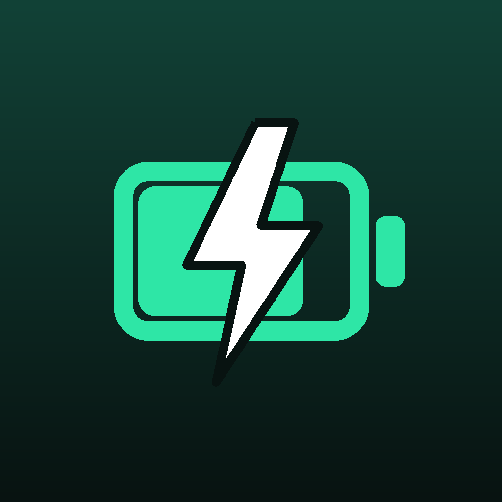

<p align="center"></p>

# LeafPulse

**Free iOS app for Nissan LEAF owners who use Home Assistant.**

  

LeafPulse reads your LEAF's battery through a Vgate vLinker MC+ Bluetooth OBD adapter and sends it to Home Assistant, so you can see battery health over time and have your charger stop at a set limit (80% by default) without opening any app.

> **Tested on one car:** a 2021 Nissan LEAF S Plus (62 kWh, ZE1) with a Vgate vLinker MC+ (BLE). Everything else below is labelled by how much it has actually been checked.

### Compatibility

Second-generation (ZE1) LEAFs are 2018–2025 models. The 2026 third-generation LEAF is a different car and is **not supported**.

| Feature | 2021 S Plus 62 kWh (owner's car) | Other ZE1, 40/62 kWh (2018–2025) | ZE0/AZE0, 24/30 kWh (2011–2017) |
| --- | --- | --- | --- |
| SOC, Ah, Hx, SOH | ✅ Tested on the car | ⚠️ Same layout, untested | 🧪 Ah/Hx decoded from published samples; SOC not read; SOH estimated |
| Cell voltages, temperatures | ✅ Tested on the car | ⚠️ Untested | 🧪 Published samples only |
| Home Assistant upload and 80% auto-stop | ✅ Used daily by the owner | ⚠️ Untested | ❌ Auto-stop needs SOC, which older cars don't report here |
| Cell balancing | ❌ Hidden: the 2018+ layout decodes wrong (about 70 of 96 cells); needs a raw capture | ❌ Hidden | 🧪 Older layout from OVMS |
| Charge counts, 12V, VIN | 🧪 From OVMS, awaiting a capture | 🧪 | 🧪 |
| Fault codes (read/clear) | 🧪 Standard requests, awaiting a test | 🧪 | 🧪 |

✅ tested on real hardware · ⚠️ should work, not yet tried · 🧪 written from published protocol data, not yet confirmed on a car · ❌ not available

Pack size is only shown as *detected* when the reply proves it; otherwise it says *best guess*, and you can set it by hand in Settings (for replacement or upgraded packs). Capacity in kWh is an estimate (Ah × 350 V), not a measured range test.

Protocol details follow the open-source [OVMS](https://github.com/openvehicles/Open-Vehicle-Monitoring-System-3) project and the public [LEAF CAN list](https://github.com/dalathegreat/leaf_can_bus_messages). If you try LeafPulse on another LEAF, please open an Issue with your connection log (Share button in the app; the VIN is removed automatically).

Made by **[Aprexer](https://github.com/Aprexer)**. Independent project, not affiliated with Nissan, Vgate, Wallbox, or LeafSpy.

## What it does

**On the iPhone**
- State of charge, battery health (SOH), capacity (Ah), Hx, all 96 cell-pair voltages (with min/max/difference) and pack temperatures.
- Runs in the background and reconnects by itself when the car is on.
- Keeps listening for 20 minutes after you switch off, so short stops need no taps.
- Fault codes: scans the battery controller, VCM, charger, inverter, brakes, body, cluster and climate modules for stored trouble codes, with a one-tap web lookup for each. You can clear them after a confirmation, and the app re-reads to show whether they came back. Clearing never happens automatically or from Home Assistant.
- Vehicle data: quick-charge (CHAdeMO) and L1/L2 charge counts, 12V battery voltage and current, and the VIN (hidden until you tap Show).
- Battery pack size (24, 30, 40 or 62 kWh) detected when the car's reply proves it, remembered for next time, or set by hand for replacement packs. Capacity shows as kWh out of that size.
- Warns you if the app is closed while it's working.
- **Live Activity while driving** (iOS 18+): SOC, energy left, pack temperature, cell gap and 12V on the Lock Screen, Dynamic Island and the **CarPlay Dashboard** (iOS 26). It turns amber and says so if updates stop, and shows the final reading for 15 minutes after you park.
- **Widget** for the Home Screen, StandBy, Lock Screen and **CarPlay** (iOS 26): last reading and how old it is.

**In Home Assistant**
- Publishes `sensor.leaf_*` entities: state of charge, SOH, capacity (Ah and kWh), Hx, pack voltage, lowest/highest cell, cell difference, max/average pack temperature, quick-charge and L1/L2 counts, 12V battery voltage and current. Each carries the time it was actually read. The VIN is never sent.
- Sends your final readings the moment you park; if you're offline, readings are queued and retried in the background until delivered.
- Charge limit package (`home-assistant/leafpulse_package.yaml` + blueprint): pauses your charger at your limit, with a one-tap "charge to 100%" bypass and a notification with the cost. Works with any charger that has a power sensor, an energy sensor and a pause/resume switch in Home Assistant.
- Optional custom card (`home-assistant/leaf-charge-card.js`): animated charge ring, time to your limit, live charging cost, 12V and charge-count tiles, and the bypass button. It always says whether a number is live, estimated or old.

## Install

### Flekstore, AltStore, Feather, ESign and other source-based stores

Add this source:

```
https://raw.githubusercontent.com/Aprexer/LeafPulse/main/apps.json
```

Then install **LeafPulse** from it. The store signs it with your own certificate, and new versions show up as updates.

### Moving from an older LeafPulse

The app's ID is now `com.aprexer.leafpulse`, so iOS treats it as a new app. Delete any older LeafPulse, install it again from the source, then re-enter your Home Assistant URL and token and tap **Find my vLinker** once.

## Setup

1. Plug the vLinker MC+ into the LEAF's OBD port. For automatic wake-up when you turn the car on, update the vLinker to firmware **2.2.82 or later** with Vgate's firmware updater app.
2. Open LeafPulse, allow Bluetooth and notifications, and tap **Find my vLinker** once. It reconnects automatically after that.
3. Tap the house icon: enter your Home Assistant URL (use your external HTTPS address so updates work away from home) and a long-lived access token, then **Send test sensor**.
4. Keep Background App Refresh on, and don't swipe the app away in the app switcher. iOS cancels background uploads for apps you swipe away.

### Live Activity and CarPlay

iOS only lets a Live Activity start while the app is on screen, so for it to appear on its own in the car, add a Shortcuts automation once:

**Shortcuts → Automation → + → CarPlay → Connects → Run Immediately → add "Show LeafPulse while driving".**

To put the widget on CarPlay: **Settings → General → CarPlay → your car → Widgets**, then add LeafPulse.

LeafPulse isn't a full CarPlay app: that needs a CarPlay entitlement from Apple for the account that signs the app. The widget and Live Activity don't.

If you install with a signing service (Flekstore, AltStore, etc.), the widget finds its data through the app group in your provisioning profile. If your profile has no app groups, the widget can't show readings, but the Live Activity still works.

### Charge limit in Home Assistant

1. Copy `home-assistant/leafpulse_package.yaml` to `config/packages/leafpulse.yaml`, and make sure `configuration.yaml` has:
   ```yaml
   homeassistant:
     packages: !include_dir_named packages
   ```
2. Restart Home Assistant. This adds the charge-limit helpers, `sensor.leaf_estimated_state_of_charge` and `sensor.leaf_charge_time_remaining`.
3. Import the blueprint: **Settings → Automations & scenes → Blueprints → Import blueprint**, and paste
   `https://github.com/Aprexer/LeafPulse/blob/main/home-assistant/leafpulse_charge_limit_blueprint.yaml`
4. Create an automation from it and pick your charger's status, power, energy and pause/resume entities, plus your phone's notify service.

How it works: when you plug in, it takes LeafPulse's last reading (if it's under 12 hours old, adjustable) or the previous charge's estimate if the car hasn't reported since. It then adds the charger's energy, minus about 12% charging losses (adjustable), and pauses the charger at your limit. If no reading is recent enough, it tells you and **doesn't** stop that charge. A fresh reading from the car always overrides the estimate.

If you already made these helpers by hand, skip the package and only use the parts you're missing.

## Licence

LeafPulse is **free to download and use**. Copyright (C) 2026 Aprexer. All rights reserved.

- **You can** install it, use it, and share the link to this page.
- **You can't** sell it, re-upload the IPA elsewhere, rebrand it, or publish it (or a copy of it) on the App Store or any other store without written permission.
- It comes with **no warranty**. Check its readings against another tool before relying on them.

The app's source code is private. Versions **1.0.10 and earlier** were released under GPL-3.0 (`LICENSE-GPL-3.0`) and stay under it; they're no longer offered here, but open an Issue if you need their source. The **Home Assistant card, package and blueprint** in `home-assistant/` are GPL-3.0 too, so you can adapt them freely.

If you see LeafPulse being sold or published by someone else, please open an Issue.

### Name and icon

The LeafPulse name and icon belong to Aprexer. Please don't use them for other apps.
